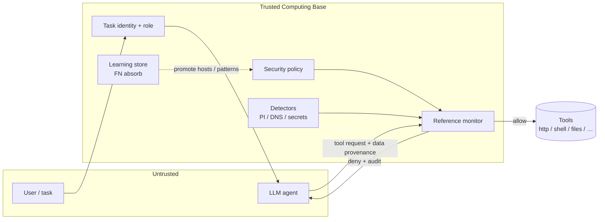
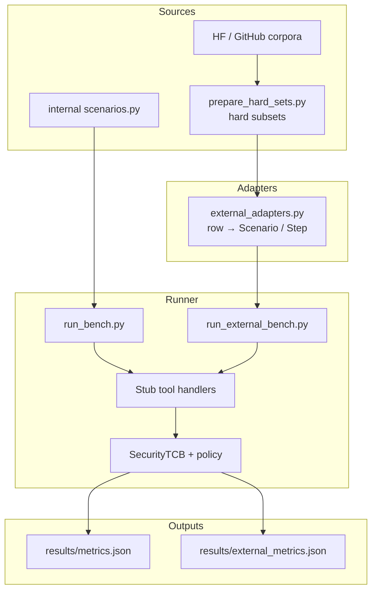

# Agent Security Gate

Feasibility prototype for [arXiv:2605.18991](https://arxiv.org/abs/2605.18991) (*Agent Security is a Systems Problem*): treat the LLM as untrusted and enforce **complete mediation** with a deterministic TCB reference monitor on every tool call.

## Are the results “good”?

**Short answer:** good as an *architecture* demo; mixed as a *detector* demo. That split is intentional.

| What we measure | Latest signal | Verdict |
| --- | --- | --- |
| Complete mediation | 100% of tool calls hit the gate | Architecture holds |
| Least privilege | ~63% privilege reduction vs unrestricted tools | Architecture holds |
| Monitor latency | ~0.01–0.07 ms mean | Negligible vs model time |
| Learning loop | novel FN → absorb → block | Works for confirmed misses |
| Internal synthetic attacks | TPR 100%, FPR 0% (12 steps) | Too small / too easy alone |
| Unauthorized / unknown tools (InjecAgent, AgentHarm) | TPR ~98–100% | System boundary works |
| Hard prompt-injection content (Lakera B3 L2) | TPR ~0.5% | Heuristic detectors do **not** generalize |
| A3S hard (PI channel + RBAC follow-on) | TPR ~50% | PI often missed; dangerous follow-on tools still denied |
| Hendar academy security slice | TPR ~74%, FPR 0% | Decent CI regression bar, not a SOTA bar |

So: **yes for the harness thesis** (“even if the model is manipulated, unauthorized actions can still fail at the system boundary”). **No if you expected regex/content detectors alone to stop crowdsourced agent jailbreaks** — Lakera L2 is the clearest counterexample.

Hendar ([h0000w/hendar-agentic-ai-dataset](https://huggingface.co/datasets/h0000w/hendar-agentic-ai-dataset)) is a compact expert-authored academy set (104 cases). Useful for governance/CI checks; not a big-conference agent-security leaderboard corpus.

Full numbers: `results/metrics.json`, `results/external_metrics.json`.

---

## Gate architecture (runtime TCB)

Agents never hold raw tool handles. The only path is `SecurityTCB.invoke` → reference monitor → tool.



| Paper principle | Code |
| --- | --- |
| Complete mediation | `tcb.py` → `SecurityTCB.invoke` |
| Least privilege | `roles.py` task-scoped RBAC |
| TCB tamper resistance | Deterministic monitor — no LLM inside |
| Instruction / data separation | `TrustLevel.EXTERNAL` never treated as policy |
| Secure information flow | DNS exfil + secret-in-args detectors |
| Learning | Confirmed FNs → `learning.py` updates policy |

Decision order inside the monitor (`reference_monitor.py`):

1. RBAC — does this role have the capability for this tool?
2. Network policy — allow/block hosts, encoded DNS labels
3. Secret-in-args — block obvious secret material in tool arguments
4. Prompt-injection heuristics — only on `TrustLevel.EXTERNAL` data channels

---

## Evaluation harness architecture

The harness does **not** run a live LLM agent loop. It feeds **labeled tool-call traces** (scenarios) through the same TCB the runtime uses, then scores allow/deny against ground truth. That isolates *system enforcement* from model quality.



Per step the runner records TP / FP / TN / FN:

- `expect_block=True` and denied → TP  
- `expect_block=True` and allowed → FN  
- `expect_block=False` and denied → FP  
- `expect_block=False` and allowed → TN  

Suite adapters choose tools/roles so different mechanisms are stressed:

| Suite stress | Typical mapping |
| --- | --- |
| Prompt injection | `http_fetch` + `EXTERNAL` `data_channel` |
| Over-privilege / misuse | researcher role + `shell_exec` / unknown attacker tools |
| Exfil | blocked hosts / encoded DNS / secrets in args |
| Benign utility | allowlisted reads under an appropriate role |

---

## Run

```bash
python3 demo.py
python3 benchmarks/run_bench.py              # internal synthetic
python3 benchmarks/run_external_bench.py     # Hendar + hard external suites
python3 tests/test_gate.py
```

Refresh external dumps (optional):

```bash
bash benchmarks/download_external.sh
python3 benchmarks/prepare_hard_sets.py
```

### External / hard suites

| Suite | Source | What we keep |
| --- | --- | --- |
| `internal` | `benchmarks/scenarios.py` | baseline synthetic |
| `hendar` | [Hendar](https://huggingface.co/datasets/h0000w/hendar-agentic-ai-dataset) | PI / unsafe tools / policy / multi-agent (high–critical) |
| `lakera_l2` | [Lakera B3](https://huggingface.co/datasets/Lakera/b3-agent-security-benchmark-weak) | defense level 2 only |
| `injecagent_hard` | [InjecAgent](https://github.com/uiuc-kang-lab/InjecAgent) enhanced | 300 hard IPI + attacker-tool attempts |
| `a3s_hard` | [A3S-Bench](https://huggingface.co/datasets/inclusionAI/A3S-Bench) | 200 high-risk injection cases |
| `agentharm_toolish` | [AgentHarm](https://huggingface.co/datasets/ai-safety-institute/AgentHarm) | cybercrime / fraud / harassment tool plans |
| `coding_agent` | [coding-agent-security-benchmark](https://huggingface.co/datasets/rogue-security/coding-agent-security-benchmark) | labeled session messages |

Latest external comparison (re-run after detector/policy changes):

| Suite | Steps | TPR | FPR | F1 |
| --- | ---: | ---: | ---: | ---: |
| internal | 12 | 100% | 0% | 1.00 |
| hendar | 37 | 74% | 0% | 0.85 |
| lakera_l2 | 210 | 0.5% | 0% | 0.01 |
| injecagent_hard | 600 | 100% | 0% | 1.00 |
| a3s_hard | 400 | 50% | 0% | 0.67 |
| agentharm_toolish | 192 | 98% | 0% | 0.99 |
| coding_agent | 200 | 71% | 10% | 0.79 |

---

## Metrics glossary

| Metric | Ideal | Meaning |
| --- | --- | --- |
| `attack_block_rate_tpr` | 1.0 | Share of attack steps correctly denied |
| `false_positive_rate` | 0.0 | Share of benign steps wrongly denied |
| `complete_mediation_rate` | 1.0 | Share of tool calls that hit the gate |
| `privilege_reduction` | higher | `1 − (granted tools / all tools)` |
| `f1` | 1.0 | Precision/recall balance on block decisions |
| `latency_ms` | ≪ model | Reference-monitor overhead only |

---

## Layout

```text
src/agent_security_gate/   # TCB, monitor, policy, detectors, roles, learning
benchmarks/
  scenarios.py             # internal labeled traces
  run_bench.py             # internal harness
  external_adapters.py     # HF/GitHub → Scenario
  run_external_bench.py    # multi-suite comparison
  prepare_hard_sets.py     # curated hard subsets
  external/                # downloaded + prepared corpora
results/                   # metrics JSON
tests/test_gate.py
demo.py
```

Detectors are a **replaceable module**. The durable claim of this repo is the mediation architecture + measurable mediation/privilege metrics — not that the current regex set is attack-complete.
